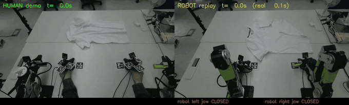
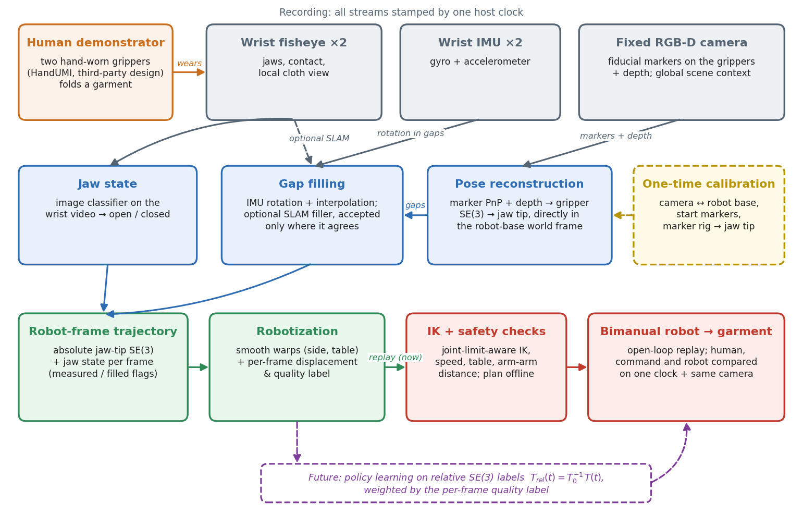
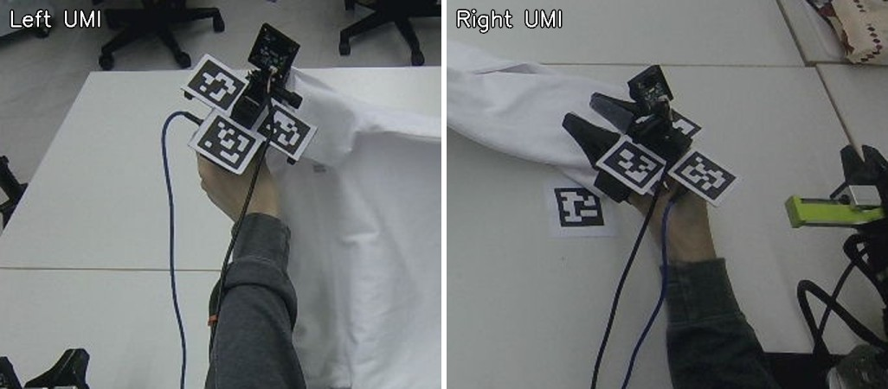
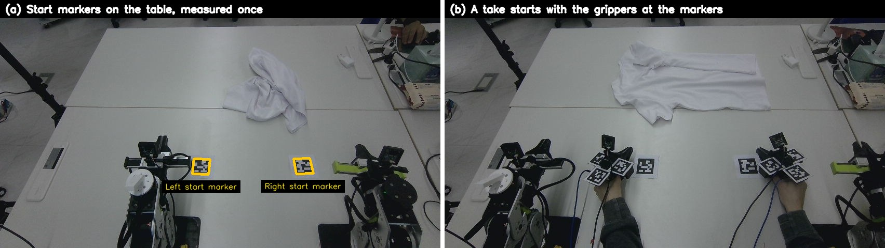
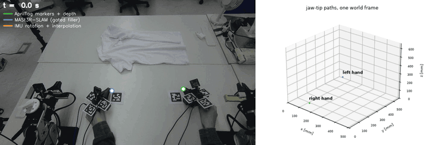
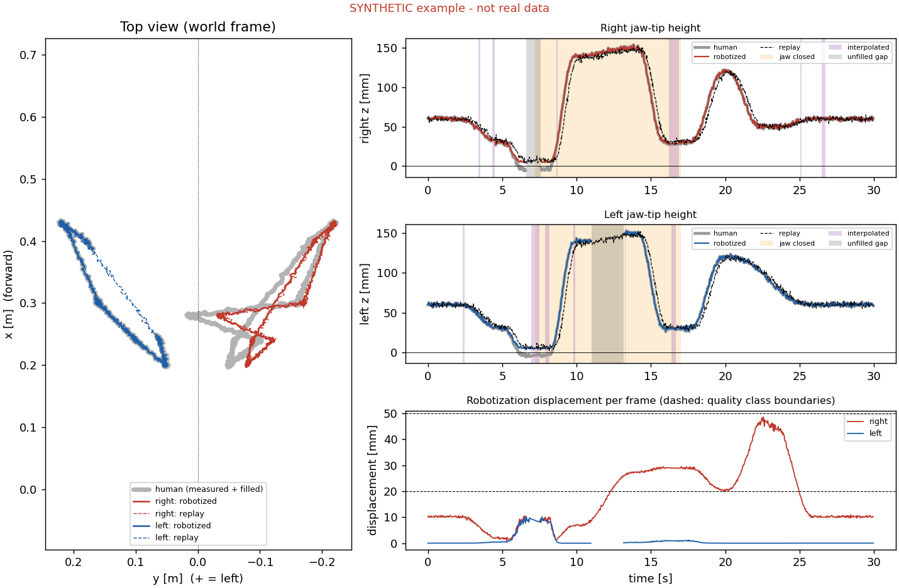

# Egocentric Human Demonstrations for Bimanual Garment Manipulation

Human garment-manipulation demonstrations, recorded with hand-worn parallel-jaw grippers, are converted into
robot-feasible end-effector trajectories and replayed on a two-arm robot, as an end-to-end test of the data before any
policy is trained on it.

> **Note.** This repository contains a sanitized research overview and selected reproducible components of an ongoing
> bimanual garment-manipulation project. Proprietary code, internal datasets, calibration parameters, robot-specific
> configurations, raw logs and model checkpoints are not included. All data in `examples/` is synthetic. The utilities
> in `scripts/` were written for this repository and are generic re-implementations of ideas described below, not the
> project's production code.

**Human demonstration (left) vs. robot replay of the converted trajectory (right).** Same fixed camera, aligned on one
clock, shown at the human's speed; the bar shows the robot jaw commands.



**Contents:** [1. Motivation and research question](#1-motivation-and-research-question) · [2. System overview](#2-system-overview) · [3. Hardware and demonstration interface](#3-hardware-and-demonstration-interface) · [4. One world frame for human and robot](#4-one-world-frame-for-human-and-robot) · [5. From recording to robot motion](#5-from-recording-to-robot-motion) · [6. Results](#6-results) · [7. What was hard, and what I changed](#7-what-was-hard-and-what-i-changed) · [8. Limitations](#8-limitations) · [9. Research directions and next steps](#9-research-directions-and-next-steps) · [10. Previous and related work](#10-previous-and-related-work) · [11. Repository and quick start](#11-repository-and-quick-start) · [12. Author](#12-author) · [13. Disclaimer](#13-disclaimer)

---

## 1. Motivation and research question

Folding a T-shirt is long-horizon, bimanual and contact-rich, and the cloth state changes with every grasp. Teleoperated
robot data for such tasks is slow and expensive to collect. Hand-held and hand-worn grippers in the style of UMI let a
person demonstrate with an end-effector that resembles the robot's, without a robot in the loop, so data collection
scales with people rather than robots.

The difficulty moves into the conversion. Every error in calibration, pose recovery, jaw labelling, timing or
kinematic feasibility ends up in the training labels, and a policy trained on those labels inherits it. Policy success
rates are a late and indirect signal for such errors.

### Research question

**Main question.** *If a robot simply replays the converted human motion, open loop, does it do what the human did?*

Replay is used as an end-to-end test of the data pipeline before policy learning. It has three useful properties:

1. it exercises every stage at once (calibration, pose, jaw state, robotization, IK, timing, control);
2. human, robot command and measured robot motion can be put on one clock and in one frame, so errors can be attributed
   to a stage (conversion vs. planning vs. tracking);
3. it fails visibly and physically (the jaws close above the cloth, or on the empty table).

Subsidiary questions: Where does the pose come from when the hand hides the markers during a grasp? How much does the
human path have to be changed to become feasible for the robot, and how should that be recorded? Which errors are
invisible to model-based checks?

## 2. System overview



*Data flow. A person demonstrates with two hand-worn grippers; wrist fisheye cameras, wrist IMUs and a fixed RGB-D
camera record on one clock. Gripper poses are reconstructed from fiducial markers plus depth directly in one world frame
(the robot base), completed by gap filling, and paired with a jaw state from the wrist video. The robot-frame trajectory
is robotized, planned with joint-limit-aware IK and safety checks, and replayed open loop; human, command and robot are
compared. Policy learning on relative SE(3) labels is future work.*

| component | role |
|---|---|
| 2 × hand-worn gripper (HandUMI) | demonstration tool; each carries several fiducial markers (AprilTags), a wrist fisheye camera and an IMU; no jaw motor |
| Fixed RGB-D camera (Orbbec Gemini 336) | above the table; sees the markers on both grippers and the scene; colour + aligned depth |
| 2 × low-cost 6-DoF arm with parallel jaw (reBot B601-DM) | replay target |
| Host computer | records all streams on one monotonic clock; planning and robot control |
| GPU (optional) | only for the optional visual-SLAM gap filler |

Two principles run through the system:

* **One world frame.** Every pose, human or robot, is expressed in the robot base frame. The fixed camera is calibrated
  to the robot once, and every recording starts with the grippers placed on start markers whose positions in the robot
  frame were measured once. No per-recording alignment (no SLAM map, no point-cloud registration) is needed.
* **One clock.** Camera frames, IMU samples, the robot's commanded and measured joints all carry host timestamps, so
  human, command and robot can be compared sample by sample and filmed side by side by the same camera without
  synchronization hardware.

## 3. Hardware and demonstration interface



*The two hand-worn grippers (left / right), each with three fiducial markers.*

The hand-worn gripper is **HandUMI**, designed and published by **BrikHMP18** (murobotics-ai) under Apache-2.0:
<https://github.com/murobotics-ai/handumi-hw>. **It is not our design.** We printed and assembled the upstream parts and
made small changes for our use: a wrist IMU instead of VR tracking, several AprilTags per hand on different faces (so at
least one tends to face the external camera), and removal of the jaw servo (jaw state is now inferred from the wrist
video). HandUMI itself follows the Universal Manipulation Interface (UMI, Chi et al., RSS 2024). See
[ATTRIBUTION.md](ATTRIBUTION.md).

### Visual observations

| view | what it provides |
|---|---|
| **Wrist fisheye** (one per hand) | the jaws themselves (open / closed), contact, and a close-up of the local cloth; also the input of the optional SLAM filler. This is the view a robot with wrist cameras would have. |
| **Fixed external RGB-D** | global scene context (where the garment lies, both hands at once), the fiducial markers on both grippers, and metric depth. It is also the camera that films the robot replay, so human and robot appear in the same image. |

## 4. One world frame for human and robot



*(a) Start markers on the table, measured once in robot coordinates. (b) Every take starts with the grippers there.*

1. **Camera → robot.** The robot moves a marker on its wrist through many poses in front of the fixed camera; this gives the camera pose in the robot base frame. From then on, anything the camera measures is in robot coordinates.
2. **Start markers.** Two AprilTags on the table are measured once with the calibrated camera.
3. **Gripper markers → jaw tip.** A one-time rig calibration relates each gripper's markers to its jaw tip, so the camera gives the jaw-tip pose directly in robot coordinates.
4. **Every take starts at the start markers**, so every demonstration begins at known robot coordinates. No per-take alignment (SLAM map, point-cloud registration) is needed.

## 5. From recording to robot motion

### Pose reconstruction and validation

1. **Markers → gripper pose.** In each RGB-D frame the AprilTags are detected and solved individually (planar PnP), and
   the marker distance, the least accurate PnP coordinate at about 1 m, is corrected along the viewing ray by the
   aligned depth. When several tags of one gripper are visible, all their corners are solved jointly for the gripper
   pose. Rotation can additionally be stabilised by the wrist gyroscope anchored to the marker frames.
2. **Gripper → jaw tip in the robot frame.** A one-time rig calibration maps the gripper's markers to its jaw tip; the
   camera-to-robot calibration maps the result into the robot base frame.
3. **Gaps.** Markers disappear exactly when the hand grasps (palm down). Short gaps get the gyro rotation and an
   interpolated position and are flagged as not measured. Wrist-camera SLAM is an *optional* filler, accepted only for
   segments that stay close to the marker path on held-out validation frames.
4. **Jaw state.** An ImageNet-pretrained ResNet-18 per hand classifies a crop of the wrist fisheye that shows the jaws,
   with hysteresis on its output.

**Validation is geometric and physical**, not only internal: held-out reprojection for the camera-to-robot calibration,
leave-one-out and an independent pivot test for the jaw-tip rig, a tape measure for the absolute robot jaw position,
and finally the robot itself, filmed by the same camera as the human.

**Reconstructed jaw-tip trajectories** of the same demonstration. Left: the paths projected into the fixed camera, coloured
by the source of each frame: AprilTag markers + depth (green), MASt3R-SLAM gap filler (blue), IMU rotation +
interpolation where markers are hidden (orange). Right: both hands in one world frame (millimetres, offset to the
workspace corner).



### From human motion to robot motion

1. **Record** both hands from a fixed start pose on the start markers, with a spoken protocol marking demo windows.
2. **Reconstruct** the jaw-tip trajectory of each hand in the robot base frame from markers + depth.
3. **Fill gaps** (gyro rotation + interpolation; optional gated SLAM) and flag every filled frame.
4. **Label the jaw** from the wrist video.
5. **Robotize** with continuous warps only, never clipping: lateral compression toward each arm's own side with a
   softplus ceiling at the midline, and a softplus floor above the table. Store displacement and quality per frame
   ([`scripts/robotize.py`](scripts/robotize.py) shows the idea).
6. **Plan** with joint-limit-aware differential IK (position prioritised over orientation, bounded joint change per
   frame, wrist-roll relaxation about the tool axis, use of the jaw's 180° symmetry, finger-corner clearance), and issue
   jaw commands early by the measured jaw actuation latency.
7. **Check** before anything moves: IK error, joint limits and speed, TCP and link heights above the table, and the
   minimum distance between the two arms. Plans are always computed offline first.
8. **Replay** open loop and log commanded and measured joints on the host clock.
9. **Compare** three levels: A = human (markers), B = robot command (FK of commanded joints), C = robot (FK of
   encoders), plus a side-by-side video from the same camera
   ([`scripts/parity_metrics.py`](scripts/parity_metrics.py) shows the metric definitions).

### Coordinate representation

* **Storage: absolute poses in the world frame.** Each frame stores the jaw-tip pose `T_B(t) ∈ SE(3)` of each hand in
  the robot base frame `B` (+x forward, +y left, +z up), the jaw state, and flags for whether the pose was measured or
  filled. The jaw-tip TCP is defined the same way for the human gripper and the robot gripper (midpoint between the jaw
  tips), so no tool offset has to be guessed later.
* **Learning contract: relative SE(3).** Learning targets are expressed relative to a reference pose `T_0` (e.g. the
  pose at the start of an action chunk):

  `T_rel(t) = T_0^{-1} T(t)`

  so the target does not depend on where in the workspace the motion happens, and the same contract applies to human
  data and to robot data. Absolute storage keeps the option of re-deriving any relative form, and is what the replay
  uses. A reference implementation of the conversion and its round trip is in
  [`scripts/relative_se3.py`](scripts/relative_se3.py).
* **Per-frame quality.** Robotization stores, for every frame, how far the robot target was moved from the human path,
  and a coarse quality class derived from it; filled frames are flagged separately. These are intended as label weights.

## 6. Results

Measured in October 2026 on one setup with one demonstrator. Full tables and metric definitions:
[docs/results.md](docs/results.md).

| milestone | result |
|---|---|
| Calibration | camera ↔ robot: 0.98 px held-out reprojection (≈1.3 mm lateral); marker rig → jaw tip: 1–4 mm static (leave-one-out 1.8–4.8 mm) |
| Single-arm replay parity | 16/18 translation strokes pass; median per-axis RMSE 5.5–11.6 mm; rotation strokes 0.3–1.6° median error; command vs. human ≤ 3.4 mm, so the residual was robot tracking |
| First cloth grasp from human data | one arm replayed a grasp window of a demonstration and picked up and lifted the T-shirt |
| Full two-arm replay of one 33 s demo | four runs with one unchanged plan repeat within ≈1 mm; whole-demo position RMSE ≈17 mm (right) / ≈30 mm (left) against the robotized path, ≈22 / 32–34 mm against the raw human path |
| Jaw height at grasp | after allowing finger contact, jaws close 14–16 mm (right) / 5–19 mm (left) above the table (human ≈10 mm), within 2–8 mm of the commanded position |
| Folding like the human | **not achieved.** In the best run the jaws caught the shirt edge and dragged it; no success rate is reported |
| Wrist-camera SLAM as pose source | **rejected.** MASt3R-SLAM kept 19–48 % of frames (0–38 % around grasps); ORB-SLAM3 mono-inertial scale diverged |

## 7. What was hard, and what I changed

| problem | decision | why |
|---|---|---|
| Wrist-camera SLAM loses tracking at the moment of grasp (close range, white cloth, fast motion) | **Absolute markers + depth from a fixed camera** as the pose source; SLAM only as a gated filler | SLAM was accurate where it tracked (a few mm) but missing exactly where labels matter. Mono-inertial scale diverged because hand accelerations were below the accelerometer bias |
| Earlier label pipeline (SLAM + body tracking + IMU) passed its own quality checks but was 4–6 cm off | **Measure in the world, not in the model** | A stale camera–IMU rotation, a mis-converged lever arm and a wrong anchor were invisible to internal residuals; they were found against the external camera |
| Robot model errors (tool-centre-point and arm mounting) invisible to FK-vs-FK parity | **Tape, camera and cloth as ground truth**; model corrections applied inside the IK model | Relative parity metrics cancel constant offsets; the robot reached the right shape in the wrong place |
| Jaws closed several cm above the cloth | **Fix the conversion, don't add heuristics**: allow the finger corner to touch the table plane, as human fingers do | Heuristics (tilt the tool, close at the lowest nearby point) were tried and rejected; tilting made the IK fail |
| Hands crossing the midline, targets below the table | **Continuous warps + per-frame quality**, never clipping | Clipping creates jumps and hides how much a label was changed |
| Aligning camera, IMU, robot and video | **One host clock** for everything | Enables per-sample comparison and side-by-side video without sync hardware |
| Arm lag during moving segments did not respond to the proportional gain | **Model the controller**: with an integral-only feed-forward and no gravity model, the moving error scales with the rate of gravity-torque change over the integral gain | Tuning the integral gain reduced stroke RMSE from 25–37 mm to 12–14 mm |

## 8. Limitations

* **No success rate.** Replays were judged by measurement and video; no trials were counted.
* **One demonstration** of one take was replayed in full on both arms. The ≈1 mm repeatability shows determinism, not
  generality across demonstrations, demonstrators or garments.
* **Open loop.** The cloth must start where the human's did; in two runs the shirt lay 15–20 cm away and the jaws closed
  on the empty table.
* **Relative parity metrics hide offsets.** They are computed relative to the start of a window with lag removed;
  absolute placement was checked only by tape and video.
* **Tag-hidden phases** are interpolated (about a fifth of the right-hand frames of the full demo); their error at the
  grasps is not measured.
* **Jaw labels** have no held-out accuracy number on demonstration takes.

## 9. Research directions and next steps

### Research directions

1. **Egocentric capture.** Wearable demonstration hardware and a recording protocol that yields synchronized wrist
   video, inertial data and an external view of a full garment task.
2. **Metric wrist-pose recovery in a consistent world frame.** Recovering the 6-DoF jaw-tip pose of both hands, with
   metric scale, in the robot's own base frame, including through contact phases where markers or visual tracking are
   lost.
3. **Cross-embodiment trajectory representation and feasibility.** Turning human hand motion into robot end-effector
   targets: what to keep absolute, what to make relative, how to warp an infeasible path without destroying its intent,
   and how to grade each frame.
4. **Long-horizon garment policy learning.** Comparing an end-to-end policy with a stage-conditioned one (grasp, lift,
   fold, release) trained on the converted labels. *This project has not started policy training yet.*

### Open questions

1. Is the remaining ≈2–3 cm trajectory error (not yet measured at the grasp points themselves) a constant bias (calibration) or varying (needs visual correction at the
   grasp)? A per-grasp error table from the video will tell.
2. Can tag-hidden contact phases be recovered well enough by an offline smoother (markers, IMU, depth, gated SLAM) with
   confidence-weighted labels?
3. Does weighting labels by robotization quality matter for policy learning, and in which phases?
4. End-to-end vs. stage-conditioned policies for long-horizon garment tasks, trained on relative SE(3) labels from
   human data.

### Status and next steps

* **Status:** the pipeline from recording to two-arm replay runs end to end; replays are deterministic; grasp height
  matches the human; folding does not yet succeed.
* **Next:** per-grasp error analysis; a cloth-placement reference before each replay; an offline smoother for
  tag-hidden phases; then the first policy training on relative labels weighted by per-frame quality, evaluated with
  counted trials.

## 10. Previous and related work

### Previous work

An earlier project, [egocentric-human-demos-rebot](https://github.com/physical-ai-vla/egocentric-human-demos-rebot),
collected 349 bimanual human demonstrations, converted them across embodiments into robot trajectories with relative
Cartesian actions, fine-tuned X-VLA on them, analysed the human-to-robot gap, and deployed on a dual-arm robot.

### Related work and attribution

* **UMI** (Chi et al., RSS 2024): hand-held gripper with wrist fisheye; pose from ORB-SLAM3-based monocular-inertial
  SLAM. We keep the UMI-style gripper but take pose from fixed-camera fiducials + depth, and test data by replay.
* **HandUMI** (BrikHMP18 / murobotics-ai, Apache-2.0): the hand-worn gripper hardware we use. Not our design.
* **DexUMI**, **EgoMimic**: human hands / egocentric video as a data source for robot learning.
* **ALOHA**: low-cost bimanual manipulation (teleoperated); **SpeedFolding**, **FlingBot**: learned cloth primitives.
* **AprilTag** (Olson; Wang & Olson), **IPPE**, **SQPnP**, **OpenCV**: fiducial detection and pose.
* **MASt3R-SLAM**, **ORB-SLAM3** (and Basalt, OpenVINS, AirSLAM in an earlier stereo setup): evaluated as pose sources.
* **Pink** on **Pinocchio**: differential IK; **ResNet-18** / **ImageNet**: jaw classifier backbone.

Full references are in the [technical note](report/technical_note.pdf); licences and credits in
[ATTRIBUTION.md](ATTRIBUTION.md).

## 11. Repository and quick start

### Repository structure

```
README.md            this overview
docs/
  architecture.png   data-flow figure (generated by docs/make_architecture.py)
  results.md         quantitative and qualitative results, metric definitions
  example_synthetic.png  output of the tools on the synthetic example
examples/            SYNTHETIC bimanual demo + simulated replay (CSV/NPZ) and their generator
scripts/             small self-contained utilities (numpy / scipy / matplotlib)
  trajio.py          CSV format helpers
  gap_fill.py        fill short marker gaps (lerp + slerp) and flag them
  robotize.py        continuous warps + per-frame displacement / quality
  relative_se3.py    T_rel = T_0^{-1} T(t) conversion and round-trip check
  parity_metrics.py  RMSE / p95 / rotation error between two trajectories with lag search
  plot_example.py    figure of a processed trajectory
tests/               pytest checks on the synthetic example
report/              short technical note (LaTeX source + PDF)
media/               short clip and photos of the real setup (see media/README.md)
```

### Quick start

```bash
python -m pip install -r requirements.txt
python examples/make_synthetic.py                                     # regenerate the synthetic data (seed 0)
python scripts/gap_fill.py examples/synthetic_bimanual_demo.csv out/filled.csv --max-gap 1.0
python scripts/robotize.py out/filled.csv out/robotized.csv --sep 0.05
python scripts/parity_metrics.py out/robotized.csv examples/synthetic_robot_replay.csv
python scripts/relative_se3.py out/filled.csv --chunk 1.0
python scripts/plot_example.py out/robotized.csv out/example.png --robot examples/synthetic_robot_replay.csv
python -m pytest -q tests
```

Expected parity output on the synthetic data: recovered lag ≈0.2–0.26 s (the generator uses 0.25 s), position RMSE
≈6 mm. Comparing the *unrobotized* human path with the replay instead gives ≈17 mm for the right hand: the difference
is the robotization displacement, the analogue of the "command vs. human" term in the real analysis.



## 12. Author

**Jeong Hwan Lee** — Robotics Engineer, Physical AI / Robot Learning

Interests: learning robot manipulation from human demonstrations; egocentric and wearable data capture;
cross-embodiment action representations; bimanual and deformable-object manipulation; vision-language-action models;
calibration and evaluation methodology for robot-learning data.

GitHub: <https://github.com/physical-ai-vla>

## 13. Disclaimer

This is a research overview of work in progress, not a product. Numbers are from one setup, one demonstrator and a
small number of runs, and are reported as measured, including failures. Code in this repository is released under the
MIT licence ([LICENSE](LICENSE)); third-party designs and methods remain under their own licences
([ATTRIBUTION.md](ATTRIBUTION.md)).
